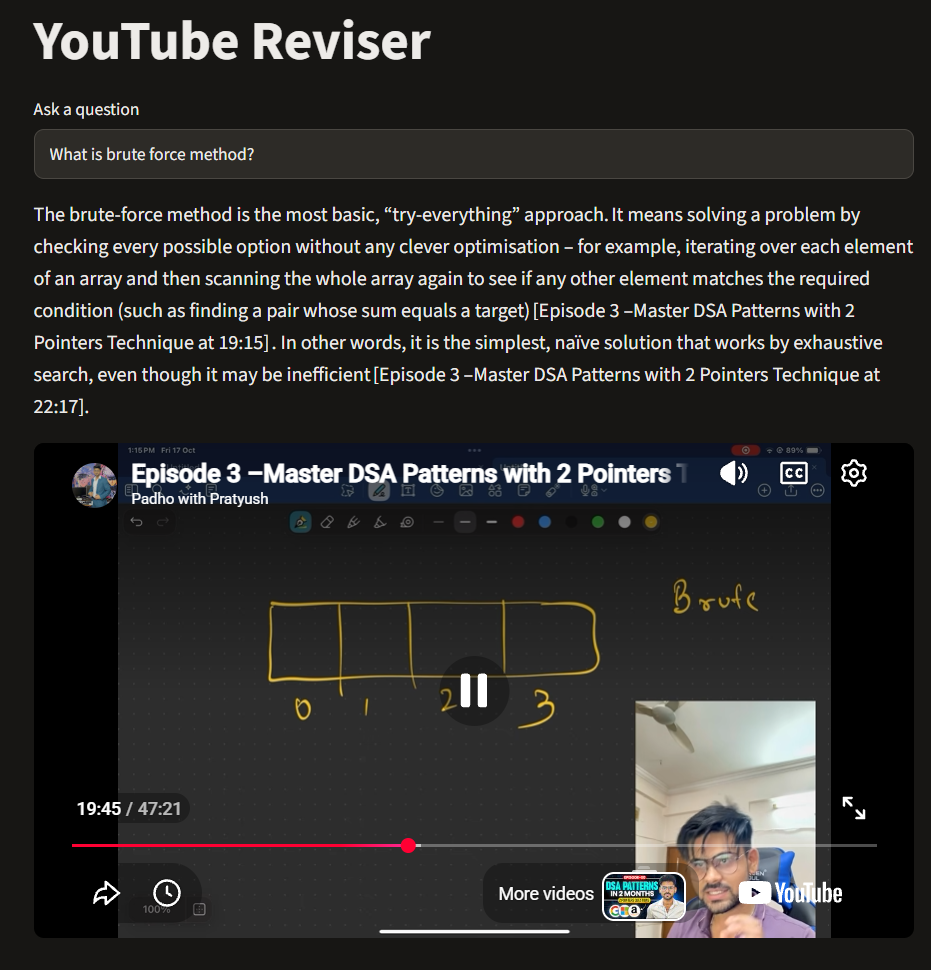

# YouTube Reviser

Ask a question about a YouTube playlist and get an answer with citations, plus the video playing at the exact moment that covers it.

I built this because I couldn't remember which video in a long DSA playlist explained a given topic. [Add one sentence in your own words.]

**Live demo:** [Youtube Reviser]<https://youtube-reviser.streamlit.app/>



## How it works

1. **Download audio** from a playlist with yt-dlp (`yt_scraper.py`)
2. **Transcribe** with faster-whisper large-v3, with word-level timestamps (`transcribe.py`, run on a free Colab GPU)
3. **Chunk** the transcript into ~60-second pieces, keeping each chunk's video ID and start time (`chunker.py`)
4. **Embed** the chunks with a multilingual MiniLM model and store them in Qdrant (`index.py`)
5. **Answer:** embed the question, retrieve the top 5 chunks, and send them to an LLM on Groq, which answers using only those chunks and cites its sources (`app.py`)
6. **Play** the top result's video at its timestamp in Streamlit

## Tech stack

Python, yt-dlp, faster-whisper, sentence-transformers, Qdrant, Groq, Streamlit

## Run it locally

```bash
uv sync
```

Create a `.env` file with your Groq API key:

```
GROQ_API_KEY=your_key_here
```

Build the vector database from the included chunks, then start the app:

```bash
uv run python index.py
uv run streamlit run app.py
```

## Notes

- Hinglish transcription needed Whisper large-v3. The small and medium models made too many mistakes on Hindi mixed with English.
- Known limitations: some words in the transcripts are joined together (for example `जितनाभी`), and chunks don't overlap, so an answer that falls on a chunk boundary can be split across two chunks. The video also starts at the beginning of the matching 60-second chunk, not at the exact sentence.
- Next improvements: add overlap between chunks, fix the word spacing, and wrap the pipeline in a FastAPI backend.
